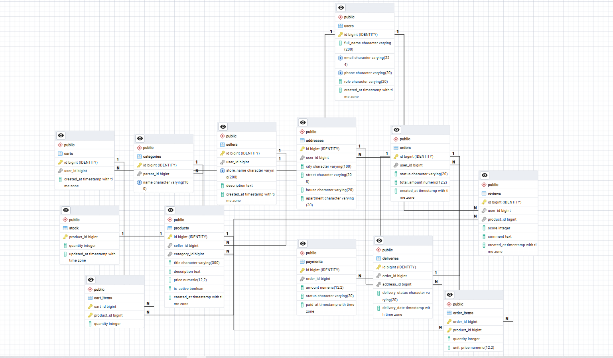

# Лабораторная работа №1
## Проектирование и создание структуры базы данных маркетплейса


---

## Содержание

1. [Цель работы](#1-цель-работы)
2. [Теоретическая база](#2-теоретическая-база)
3. [Анализ предметной области](#3-анализ-предметной-области)
4. [Бизнес-правила](#4-бизнес-правила)
5. [Сущности и связи](#5-сущности-и-связи)
6. [ER-диаграмма](#6-er-диаграмма)
7. [Нормализация до 3НФ](#7-нормализация-до-3нф)
8. [Выбор ключей](#8-выбор-ключей)
9. [Правила ссылочной целостности](#9-правила-ссылочной-целостности)
10. [Связи «многие-ко-многим»](#10-связи-многие-ко-многим)
11. [Иерархия категорий](#11-иерархия-категорий)
12. [Физическая реализация (DDL)](#12-физическая-реализация-ddl)
13. [Словарь данных](#13-словарь-данных)
14. [Индексы](#14-индексы)
15. [Проверка работоспособности](#15-проверка-работоспособности)
16. [Ответы на контрольные вопросы](#16-ответы-на-контрольные-вопросы)
17. [Вывод](#17-вывод)

---

## 1. Цель работы

Изучить теоретические основы проектирования реляционных баз данных, освоить принципы нормализации отношений до третьей нормальной формы (3НФ), спроектировать концептуальную и логическую модели для предметной области «Маркетплейс» и реализовать их средствами DDL в СУБД PostgreSQL.

**Требования задания:**
- не менее **10 сущностей**;
- минимум одна связь **«многие-ко-многим»** через ассоциативную таблицу;
- минимум одна **иерархическая связь** (самоссылка);
- схема, приведённая к **3НФ**;
- обоснование выбора **первичных ключей**;
- все виды ограничений: `NOT NULL`, `UNIQUE`, `CHECK`, `DEFAULT`, `PRIMARY KEY`, `FOREIGN KEY`;
- правила `ON DELETE / ON UPDATE`;
- **словарь данных**;
- единый **повторно запускаемый** SQL-скрипт.

---

## 2. Теоретическая база

### 2.1. Реляционная модель данных

Реляционная модель (Э. Кодд, 1970) представляет данные в виде **отношений**. На практике отношение — это таблица.

| Термин теории | Практический аналог | Пример в схеме |
|---|---|---|
| Отношение | Таблица | `products` |
| Кортеж | Строка | одна конкретная запись о товаре |
| Атрибут | Столбец | `price`, `title`, `created_at` |
| Домен | Множество допустимых значений | `role ∈ {buyer, seller, admin}` |
| Схема отношения | Набор имён и типов столбцов | `products(id, seller_id, …)` |

**Свойства отношения:**
- строки не упорядочены (порядок задаётся только запросом через `ORDER BY`);
- все значения атомарны — в одной ячейке одно неделимое значение;
- нет двух одинаковых строк (это гарантирует первичный ключ);
- схема фиксируется при создании таблицы.

### 2.2. Три уровня моделей данных

| Уровень | Что описывает | В работе |
|---|---|---|
| **Концептуальная** | сущности и связи, без привязки к СУБД | ER-диаграмма |
| **Логическая** | атрибуты, ключи, типы связей, 3НФ | таблицы + PK/FK |
| **Физическая** | конкретные типы и ограничения PostgreSQL | файл `lab_1schema.sql` |

### 2.3. Три вида целостности

- **Доменная** — значение принадлежит допустимому множеству → реализуется `CHECK`, `NOT NULL`, типом данных.
- **Сущностная** — каждая строка уникально идентифицируется → реализуется `PRIMARY KEY`, `UNIQUE`.
- **Ссылочная** — внешние ключи указывают на существующие строки → реализуется `FOREIGN KEY`.

---

## 3. Анализ предметной области

**Маркетплейс** — электронная площадка, связывающая покупателей и продавцов. Пользователь регистрируется и получает роль. Продавец создаёт магазин и размещает товары, распределяя их по иерархическому дереву категорий. Покупатель собирает товары в корзину, оформляет заказы, оплачивает их, получает доставку и оставляет отзывы.

**Функции системы:**
- регистрация и разграничение ролей пользователей (покупатель, продавец, администратор);
- каталог товаров с привязкой к продавцу и категории;
- учёт остатков на складе;
- корзина покупателя;
- оформление и обработка заказов;
- фиксация платежей и доставок;
- сбор отзывов и оценок.

---

## 4. Бизнес-правила

| № | Правило | Реализация в схеме |
|---|---------|---------------------|
| 1 | Email и телефон пользователя уникальны | `UNIQUE (email)`, `UNIQUE (phone)` в `users` |
| 2 | Роль — только `buyer`, `seller`, `admin` | `CHECK (role IN (...))` |
| 3 | Один пользователь — не более одного профиля продавца | `UNIQUE (user_id)` в `sellers` |
| 4 | Название магазина уникально | `UNIQUE (store_name)` |
| 5 | Категории образуют дерево | самоссылка `parent_id → categories(id)` |
| 6 | Название категории уникально | `UNIQUE (name)` |
| 7 | У товара ровно один продавец и одна категория | `NOT NULL` FK в `products` |
| 8 | Цена товара > 0 | `CHECK (price > 0)` |
| 9 | На товар — не более одной складской записи | `PRIMARY KEY` на `stock.product_id` |
| 10 | Остаток не может быть отрицательным | `CHECK (quantity >= 0)` |
| 11 | Количество в корзине/заказе > 0 | `CHECK (quantity > 0)` |
| 12 | Цена фиксируется на момент покупки | поле `unit_price` в `order_items` |
| 13 | Статусы ограничены перечислениями | `CHECK` на `status`, `delivery_status` |
| 14 | Один отзыв на пару (пользователь, товар) | `UNIQUE (user_id, product_id)` в `reviews` |
| 15 | Оценка в отзыве — от 1 до 5 | `CHECK (score BETWEEN 1 AND 5)` |
| 16 | На заказ — не более одной доставки | `UNIQUE (order_id)` в `deliveries` |
| 17 | Нельзя удалить продавца/товар/категорию/пользователя с заказами | `ON DELETE RESTRICT` |
| 18 | Удаление заказа каскадно удаляет позиции/платежи/доставку | `ON DELETE CASCADE` |

---

## 5. Сущности и связи

В схеме **13 таблиц**.

| Таблица | Назначение | Тип связи |
|---------|------------|-----------|
| `users` | Пользователи | 1:1 с `sellers`; 1:N с `addresses`, `carts`, `orders`, `reviews` |
| `categories` | Иерархия категорий | **самоссылка** `parent_id`; 1:N с `products` |
| `sellers` | Профили магазинов | 1:1 с `users`; 1:N с `products` |
| `products` | Каталог товаров | 1:1 с `stock`; 1:N с `cart_items`, `order_items`, `reviews` |
| `stock` | Остатки на складе | 1:1 с `products` |
| `carts` | Корзины | 1:N с `cart_items` |
| `cart_items` | Позиции корзины | **M:N** `carts × products` |
| `orders` | Заказы | 1:N с `order_items`, `payments`; 1:1 с `deliveries` |
| `order_items` | Позиции заказа | **M:N** `orders × products` |
| `payments` | Платежи | 1:N с `orders` |
| `reviews` | Отзывы | M:N `users × products` (с атрибутами) |
| `addresses` | Адреса доставки | 1:N с `users`; 1:N с `deliveries` |
| `deliveries` | Доставка заказа | 1:1 с `orders`; N:1 с `addresses` |

**Итог:**
- **13 сущностей** (требование ≥ 10 — выполнено);
- **две классические M:N** через ассоциативные таблицы (`cart_items`, `order_items`);
- **одна иерархическая связь** — самоссылка `categories.parent_id`.

---

## 6. ER-диаграмма



**Обозначения:**
- PK — первичный ключ;
- FK — внешний ключ;
- NN — `NOT NULL`;
- связь 1:1, 1:N, M:N показана линиями с указанием кардинальности.

---

## 7. Нормализация до 3НФ

### 7.1. Первая нормальная форма (1НФ)

**Требование:** все значения атомарны, нет списков и повторяющихся групп.

Плохо: хранить товары заказа строкой `products = '1,2,3'`.

Хорошо: вынести в отдельную таблицу `order_items`.

**В нашей схеме:** товары в заказе — отдельные строки в `order_items`; товары в корзине — в `cart_items`. Ни в одной ячейке нет списков.

### 7.2. Вторая нормальная форма (2НФ)

**Требование:** каждый неключевой атрибут функционально полно зависит от **всего составного PK**, а не от его части.

Плохо: `order_items(order_id, product_id, quantity, product_title)` — `product_title` зависит только от `product_id`, а не от всей пары.

Хорошо: `product_title` живёт в `products`; в `order_items` остаются только `quantity` и `unit_price`, зависящие от всей пары.

### 7.3. Третья нормальная форма (3НФ)

**Требование:** нет транзитивных зависимостей — неключевой атрибут не должен зависеть от другого неключевого.

**Пример аномалии до нормализации.** Пусть вся информация хранится в одной таблице:

```
products_denorm(product_id, title, price,
                seller_id, seller_store_name, seller_email,
                category_id, category_name)
```

Здесь:
- `seller_store_name`, `seller_email` зависят от `seller_id`, а не от `product_id` → **транзитивная зависимость**;
- `category_name` зависит от `category_id`, а не от `product_id` → тоже транзитивная.

**Аномалии:**
- **обновления** — при смене названия магазина нужно править много строк;
- **вставки** — нельзя добавить продавца без товара;
- **удаления** — удалив последний товар продавца, теряем данные о продавце.

**Как устранено в нашей схеме.** Продавцы вынесены в `sellers`, категории — в `categories`, а в `products` остались только внешние ключи:

```sql
CREATE TABLE sellers    (id, store_name, description, …);
CREATE TABLE categories (id, parent_id, name);
CREATE TABLE products   (id, seller_id, category_id, title, price, …);
```

Транзитивные зависимости исчезли, аномалии устранены.

### 7.4. БКНФ (упоминание)

Усиление 3НФ: любая функциональная зависимость исходит из потенциального ключа. На практике 3НФ устраняет большинство аномалий и считается базовым целевым уровнем. Наша схема приведена к 3НФ.

### 7.5. Осознанная денормализация

Поле `orders.total_amount` можно было бы всегда пересчитывать из `order_items`, но храним как отдельное поле — ради производительности. Плата — поддержка согласованности при обновлении.

---

## 8. Выбор ключей

| Таблица | PK | Тип | Обоснование |
|---|---|---|---|
| `users` | `id` | суррогатный | email/phone могут меняться |
| `categories` | `id` | суррогатный | name может меняться; иерархия требует стабильного id |
| `sellers` | `id` | суррогатный | store_name может меняться |
| `products` | `id` | суррогатный | title не уникален |
| `stock` | `product_id` | **естественный (FK)** | связь 1:1, отдельный id не нужен |
| `carts` | `id` | суррогатный | техническая сущность |
| `cart_items` | `(cart_id, product_id)` | **составной естественный** | уникальная пара |
| `orders` | `id` | суррогатный | номер заказа — бизнес-атрибут |
| `order_items` | `(order_id, product_id)` | **составной естественный** | уникальная пара |
| `payments` | `id` | суррогатный | у заказа несколько платежей |
| `reviews` | `id` + `UNIQUE(user_id, product_id)` | суррогатный + естественный | один отзыв на пару |
| `addresses` | `id` | суррогатный | адреса могут повторяться |
| `deliveries` | `id` + `UNIQUE(order_id)` | суррогатный + естественный | одна доставка на заказ |

**Правило выбора.** Суррогатный PK `GENERATED ALWAYS AS IDENTITY` — по умолчанию: он стабилен, компактен, не зависит от изменений бизнес-правил. Естественные ключи — там, где они действительно уникальны по смыслу: 1:1-связи (`stock`, `deliveries`) и ассоциативные таблицы (`cart_items`, `order_items`).

---

## 9. Правила ссылочной целостности

| Внешний ключ | ON DELETE | ON UPDATE | Обоснование |
|---|---|---|---|
| `categories.parent_id → categories.id` | RESTRICT | CASCADE | нельзя удалить категорию с подкатегориями |
| `sellers.user_id → users.id` | CASCADE | CASCADE | профиль продавца без пользователя не нужен |
| `products.seller_id → sellers.id` | RESTRICT | CASCADE | нельзя удалить продавца с товарами |
| `products.category_id → categories.id` | RESTRICT | CASCADE | нельзя удалить категорию с товарами |
| `stock.product_id → products.id` | CASCADE | CASCADE | складская запись без товара не нужна |
| `carts.user_id → users.id` | CASCADE | CASCADE | корзина без пользователя не нужна |
| `cart_items.cart_id → carts.id` | CASCADE | CASCADE | позиция без корзины не нужна |
| `cart_items.product_id → products.id` | CASCADE | CASCADE | товар удалён — позиции в корзинах убираем |
| `orders.user_id → users.id` | RESTRICT | CASCADE | нельзя удалить пользователя с заказами |
| `order_items.order_id → orders.id` | CASCADE | CASCADE | удалили заказ — позиции не нужны |
| `order_items.product_id → products.id` | RESTRICT | CASCADE | нельзя удалить товар из оформленного заказа |
| `payments.order_id → orders.id` | CASCADE | CASCADE | платежи без заказа не нужны |
| `reviews.user_id → users.id` | CASCADE | CASCADE | отзыв без автора не нужен |
| `reviews.product_id → products.id` | CASCADE | CASCADE | отзыв без товара не нужен |
| `addresses.user_id → users.id` | CASCADE | CASCADE | адрес без пользователя не нужен |
| `deliveries.order_id → orders.id` | CASCADE | CASCADE | доставка без заказа не нужна |
| `deliveries.address_id → addresses.id` | RESTRICT | CASCADE | нельзя удалить адрес, использованный в доставке |

**Логика выбора:**
- **RESTRICT** — защита бизнес-значимых данных (история продаж, товары продавца, категории с содержимым).
- **CASCADE** — удаление технических зависимых записей (позиции, платежи, склад, корзины, отзывы).

---

## 10. Связи «многие-ко-многим»

### 10.1. `cart_items` — корзины ↔ товары

```sql
CREATE TABLE cart_items (
    cart_id    BIGINT NOT NULL,
    product_id BIGINT NOT NULL,
    quantity   INTEGER NOT NULL,
    PRIMARY KEY (cart_id, product_id),
    CONSTRAINT fk_cart_items_cart FOREIGN KEY (cart_id)
        REFERENCES carts(id) ON DELETE CASCADE ON UPDATE CASCADE,
    CONSTRAINT fk_cart_items_product FOREIGN KEY (product_id)
        REFERENCES products(id) ON DELETE CASCADE ON UPDATE CASCADE,
    CONSTRAINT chk_cart_items_quantity CHECK (quantity > 0)
);
```

**Признаки M:N:** два FK, составной PK `(cart_id, product_id)`, собственный атрибут связи — `quantity`.

### 10.2. `order_items` — заказы ↔ товары

```sql
CREATE TABLE order_items (
    order_id   BIGINT NOT NULL,
    product_id BIGINT NOT NULL,
    quantity   INTEGER NOT NULL,
    unit_price NUMERIC(12,2) NOT NULL,
    PRIMARY KEY (order_id, product_id),
    CONSTRAINT fk_order_items_order FOREIGN KEY (order_id)
        REFERENCES orders(id) ON DELETE CASCADE ON UPDATE CASCADE,
    CONSTRAINT fk_order_items_product FOREIGN KEY (product_id)
        REFERENCES products(id) ON DELETE RESTRICT ON UPDATE CASCADE,
    CONSTRAINT chk_order_items_quantity CHECK (quantity > 0),
    CONSTRAINT chk_order_items_price CHECK (unit_price > 0)
);
```

**Признаки M:N:** два FK, составной PK, атрибуты `quantity` и `unit_price` (цена на момент покупки).

### 10.3. `reviews` — пользователи ↔ товары (M:N с атрибутами)

Формально тоже M:N, но PK суррогатный, а правило «один отзыв на пару» задано отдельно:

```sql
CONSTRAINT uq_reviews_user_product UNIQUE (user_id, product_id)
```

### 10.4. Почему M:N нельзя реализовать иначе

Идея «хранить список ID в одной ячейке» **нарушает 1НФ**, делает невозможными FK и нормальный поиск. В реляционной модели M:N **всегда** реализуется через ассоциативную таблицу.

---

## 11. Иерархия категорий

**Способ «Список смежности»:** таблица ссылается сама на себя.

```sql
CREATE TABLE categories (
    id         BIGINT GENERATED ALWAYS AS IDENTITY PRIMARY KEY,
    parent_id  BIGINT REFERENCES categories(id)
        ON DELETE RESTRICT ON UPDATE CASCADE,
    name       VARCHAR(100) NOT NULL,
    CONSTRAINT uq_categories_name UNIQUE (name)
);
```

- Корневые категории — `parent_id IS NULL`.
- Дочерние — указывают на id родителя.
- `ON DELETE RESTRICT` — нельзя удалить категорию с подкатегориями.

**Пример:**

| id | parent_id | name |
|---|---|---|
| 1 | NULL | Электроника |
| 2 | 1 | Смартфоны |
| 3 | 1 | Ноутбуки |
| 4 | NULL | Одежда |

**Обход поддерева — рекурсивный запрос:**

```sql
WITH RECURSIVE subtree AS (
    SELECT id, parent_id, name, 1 AS level
    FROM categories WHERE id = 1
    UNION ALL
    SELECT c.id, c.parent_id, c.name, s.level + 1
    FROM categories c JOIN subtree s ON c.parent_id = s.id
)
SELECT * FROM subtree ORDER BY level, id;
```

---

## 12. Физическая реализация (DDL)

Полный скрипт — в файле [`lab_1schema.sql`](./lab_1schema.sql). Особенности:

- **Идемпотентность** — начинается с `DROP TABLE IF EXISTS ... CASCADE`, поэтому может выполняться повторно.
- **PK** — `BIGINT GENERATED ALWAYS AS IDENTITY` (суррогатный, стабильный).
- **Деньги** — `NUMERIC(12,2)` (точные числа, без ошибок округления — в отличие от `FLOAT`).
- **Дата-время** — `TIMESTAMPTZ` (с часовым поясом).
- **Строки** — `VARCHAR(n)` с разумными ограничениями длины.
- **Индексы** — по внешним ключам (PostgreSQL не индексирует FK автоматически).

**Фрагмент скрипта:**

```sql
-- Пользователи
CREATE TABLE users (
    id          BIGINT GENERATED ALWAYS AS IDENTITY PRIMARY KEY,
    full_name   VARCHAR(200) NOT NULL,
    email       VARCHAR(254) NOT NULL,
    phone       VARCHAR(20),
    role        VARCHAR(20)  NOT NULL DEFAULT 'buyer',
    created_at  TIMESTAMPTZ  NOT NULL DEFAULT now(),
    CONSTRAINT uq_users_email UNIQUE (email),
    CONSTRAINT uq_users_phone UNIQUE (phone),
    CONSTRAINT chk_users_role CHECK (role IN ('buyer','seller','admin'))
);

-- Категории (иерархия)
CREATE TABLE categories (
    id         BIGINT GENERATED ALWAYS AS IDENTITY PRIMARY KEY,
    parent_id  BIGINT REFERENCES categories(id)
        ON DELETE RESTRICT ON UPDATE CASCADE,
    name       VARCHAR(100) NOT NULL,
    CONSTRAINT uq_categories_name UNIQUE (name)
);

-- Позиции заказа (с фиксацией цены покупки)
CREATE TABLE order_items (
    order_id   BIGINT NOT NULL,
    product_id BIGINT NOT NULL,
    quantity   INTEGER NOT NULL,
    unit_price NUMERIC(12,2) NOT NULL,
    PRIMARY KEY (order_id, product_id),
    CONSTRAINT fk_order_items_order FOREIGN KEY (order_id)
        REFERENCES orders(id) ON DELETE CASCADE ON UPDATE CASCADE,
    CONSTRAINT fk_order_items_product FOREIGN KEY (product_id)
        REFERENCES products(id) ON DELETE RESTRICT ON UPDATE CASCADE,
    CONSTRAINT chk_order_items_quantity CHECK (quantity > 0),
    CONSTRAINT chk_order_items_price CHECK (unit_price > 0)
);
```

**Запуск:**

```bash
psql -U postgres -d marketplace -f lab_1schema.sql
```

Или через pgAdmin: Query Tool → открыть `lab_1schema.sql` → Execute.

---

## 13. Словарь данных

### 13.1. `users` — пользователи

| Столбец | Тип | Ограничения | Назначение |
|---|---|---|---|
| `id` | `BIGINT` | PK, IDENTITY | Идентификатор |
| `full_name` | `VARCHAR(200)` | NOT NULL | ФИО |
| `email` | `VARCHAR(254)` | NOT NULL, UNIQUE | Email |
| `phone` | `VARCHAR(20)` | UNIQUE | Телефон |
| `role` | `VARCHAR(20)` | NOT NULL, DEFAULT `'buyer'`, CHECK | Роль |
| `created_at` | `TIMESTAMPTZ` | NOT NULL, DEFAULT `now()` | Дата регистрации |

### 13.2. `categories` — категории

| Столбец | Тип | Ограничения | Назначение |
|---|---|---|---|
| `id` | `BIGINT` | PK, IDENTITY | Идентификатор |
| `parent_id` | `BIGINT` | FK → `categories(id)`, NULL | Родительская категория |
| `name` | `VARCHAR(100)` | NOT NULL, UNIQUE | Название |

### 13.3. `sellers` — продавцы

| Столбец | Тип | Ограничения | Назначение |
|---|---|---|---|
| `id` | `BIGINT` | PK, IDENTITY | Идентификатор |
| `user_id` | `BIGINT` | NOT NULL, FK → `users(id)`, UNIQUE | Владелец (1:1) |
| `store_name` | `VARCHAR(200)` | NOT NULL, UNIQUE | Название магазина |
| `description` | `TEXT` | | Описание |
| `created_at` | `TIMESTAMPTZ` | NOT NULL, DEFAULT `now()` | Дата создания |

### 13.4. `products` — товары

| Столбец | Тип | Ограничения | Назначение |
|---|---|---|---|
| `id` | `BIGINT` | PK, IDENTITY | Идентификатор |
| `seller_id` | `BIGINT` | NOT NULL, FK → `sellers(id)` | Продавец |
| `category_id` | `BIGINT` | NOT NULL, FK → `categories(id)` | Категория |
| `title` | `VARCHAR(300)` | NOT NULL | Название |
| `description` | `TEXT` | | Описание |
| `price` | `NUMERIC(12,2)` | NOT NULL, CHECK > 0 | Цена |
| `is_active` | `BOOLEAN` | NOT NULL, DEFAULT TRUE | Активность |
| `created_at` | `TIMESTAMPTZ` | NOT NULL, DEFAULT `now()` | Дата добавления |

### 13.5. `stock` — остатки на складе

| Столбец | Тип | Ограничения | Назначение |
|---|---|---|---|
| `product_id` | `BIGINT` | PK, FK → `products(id)` | Товар (1:1) |
| `quantity` | `INTEGER` | NOT NULL, DEFAULT 0, CHECK ≥ 0 | Остаток |
| `updated_at` | `TIMESTAMPTZ` | NOT NULL, DEFAULT `now()` | Дата обновления |

### 13.6. `carts` — корзины

| Столбец | Тип | Ограничения | Назначение |
|---|---|---|---|
| `id` | `BIGINT` | PK, IDENTITY | Идентификатор |
| `user_id` | `BIGINT` | NOT NULL, FK → `users(id)` | Владелец |
| `created_at` | `TIMESTAMPTZ` | NOT NULL, DEFAULT `now()` | Дата создания |

### 13.7. `cart_items` — позиции корзины

| Столбец | Тип | Ограничения | Назначение |
|---|---|---|---|
| `cart_id` | `BIGINT` | PK, FK → `carts(id)` | Корзина |
| `product_id` | `BIGINT` | PK, FK → `products(id)` | Товар |
| `quantity` | `INTEGER` | NOT NULL, CHECK > 0 | Количество |

### 13.8. `orders` — заказы

| Столбец | Тип | Ограничения | Назначение |
|---|---|---|---|
| `id` | `BIGINT` | PK, IDENTITY | Номер заказа |
| `user_id` | `BIGINT` | NOT NULL, FK → `users(id)` | Покупатель |
| `status` | `VARCHAR(20)` | NOT NULL, DEFAULT `'created'`, CHECK | Статус |
| `total_amount` | `NUMERIC(12,2)` | NOT NULL, DEFAULT 0, CHECK ≥ 0 | Сумма |
| `created_at` | `TIMESTAMPTZ` | NOT NULL, DEFAULT `now()` | Дата |

### 13.9. `order_items` — позиции заказа

| Столбец | Тип | Ограничения | Назначение |
|---|---|---|---|
| `order_id` | `BIGINT` | PK, FK → `orders(id)` | Заказ |
| `product_id` | `BIGINT` | PK, FK → `products(id)` | Товар |
| `quantity` | `INTEGER` | NOT NULL, CHECK > 0 | Количество |
| `unit_price` | `NUMERIC(12,2)` | NOT NULL, CHECK > 0 | Цена на момент покупки |

### 13.10. `payments` — платежи

| Столбец | Тип | Ограничения | Назначение |
|---|---|---|---|
| `id` | `BIGINT` | PK, IDENTITY | Идентификатор |
| `order_id` | `BIGINT` | NOT NULL, FK → `orders(id)` | Заказ |
| `amount` | `NUMERIC(12,2)` | NOT NULL, CHECK > 0 | Сумма |
| `status` | `VARCHAR(20)` | NOT NULL, DEFAULT `'pending'`, CHECK | Статус |
| `paid_at` | `TIMESTAMPTZ` | | Дата оплаты |

### 13.11. `reviews` — отзывы

| Столбец | Тип | Ограничения | Назначение |
|---|---|---|---|
| `id` | `BIGINT` | PK, IDENTITY | Идентификатор |
| `user_id` | `BIGINT` | NOT NULL, FK → `users(id)` | Автор |
| `product_id` | `BIGINT` | NOT NULL, FK → `products(id)` | Товар |
| `score` | `INTEGER` | NOT NULL, CHECK 1..5 | Оценка |
| `comment` | `TEXT` | | Комментарий |
| `created_at` | `TIMESTAMPTZ` | NOT NULL, DEFAULT `now()` | Дата |
| — | — | UNIQUE (`user_id`, `product_id`) | Один отзыв на пару |

### 13.12. `addresses` — адреса

| Столбец | Тип | Ограничения | Назначение |
|---|---|---|---|
| `id` | `BIGINT` | PK, IDENTITY | Идентификатор |
| `user_id` | `BIGINT` | NOT NULL, FK → `users(id)` | Владелец |
| `city` | `VARCHAR(100)` | NOT NULL | Город |
| `street` | `VARCHAR(200)` | NOT NULL | Улица |
| `house` | `VARCHAR(20)` | NOT NULL | Дом |
| `apartment` | `VARCHAR(20)` | | Квартира |

### 13.13. `deliveries` — доставки

| Столбец | Тип | Ограничения | Назначение |
|---|---|---|---|
| `id` | `BIGINT` | PK, IDENTITY | Идентификатор |
| `order_id` | `BIGINT` | NOT NULL, FK → `orders(id)`, UNIQUE | Заказ (1:1) |
| `address_id` | `BIGINT` | NOT NULL, FK → `addresses(id)` | Адрес |
| `delivery_status` | `VARCHAR(20)` | NOT NULL, DEFAULT `'pending'`, CHECK | Статус |
| `delivery_date` | `TIMESTAMPTZ` | | Дата доставки |

---

## 14. Индексы

PostgreSQL автоматически индексирует PK и UNIQUE, но **внешние ключи — нет**. Поэтому создаём индексы вручную — они ускоряют `JOIN` и каскадные операции.

```sql
CREATE INDEX idx_products_seller      ON products(seller_id);
CREATE INDEX idx_products_category    ON products(category_id);
CREATE INDEX idx_orders_user          ON orders(user_id);
CREATE INDEX idx_reviews_product      ON reviews(product_id);
CREATE INDEX idx_cart_items_product   ON cart_items(product_id);
CREATE INDEX idx_order_items_product  ON order_items(product_id);
CREATE INDEX idx_addresses_user       ON addresses(user_id);
CREATE INDEX idx_categories_parent    ON categories(parent_id);
```

---

## 15. Проверка работоспособности

```sql
-- 1. Список таблиц
\dt
-- должно быть 13 таблиц

-- 2. Проверить ограничения products
\d+ products

-- 3. Проверить все внешние ключи
SELECT conname, conrelid::regclass AS table_name
FROM pg_constraint WHERE contype = 'f';
-- должно быть 17-18 FK

-- 4. Тест CHECK: цена -5 → ошибка
INSERT INTO products (seller_id, category_id, title, price)
VALUES (1, 1, 'Тест', -5);
-- ERROR: new row violates check constraint "chk_products_price"

-- 5. Тест FK: несуществующий продавец
INSERT INTO products (seller_id, category_id, title, price)
VALUES (999, 1, 'Тест', 100);
-- ERROR: violates foreign key constraint "fk_products_seller"

-- 6. Тест RESTRICT: удалить продавца с товарами
DELETE FROM sellers WHERE id = 1;
-- ERROR: violates foreign key constraint (RESTRICT)

-- 7. Тест CASCADE: удалить заказ → уйдут позиции
DELETE FROM orders WHERE id = 1;
-- позиции, платежи и доставка исчезнут автоматически
```

---

## 16. Ответы на контрольные вопросы

### 1. Что такое реляционная модель? Отношение, кортеж, атрибут?

Реляционная модель (Э. Кодд, 1970) представляет данные в виде отношений. Отношение — таблица; кортеж — строка (запись); атрибут — столбец. Строки не упорядочены, значения атомарны. В работе: `products` — отношение, каждая строка — кортеж-товар, `price`/`title` — атрибуты.

### 2. Чем отличаются концептуальная, логическая и физическая модели?

**Концептуальная** — сущности и связи без привязки к СУБД (ER-диаграмма). **Логическая** — уточняет атрибуты, ключи, типы связей. **Физическая** — конкретные таблицы PostgreSQL с типами и ограничениями. В работе: ER → таблицы с PK/FK в 3НФ → `lab_1schema.sql`.

### 3. Первичный ключ и требования к нему?

PK — столбец или набор столбцов, уникально идентифицирующий строку. Требования: **уникальность**, **обязательность (NOT NULL)**, **стабильность**, **минимальность**. Пример: `users.id` (IDENTITY); `order_items.(order_id, product_id)` (составной).

### 4. Суррогатный и естественный ключ?

**Суррогатный** — искусственный идентификатор (`IDENTITY`, UUID): стабилен, компактен, но не нагляден. **Естественный** — из реальных атрибутов (email, артикул): нагляден, но может меняться. В работе по умолчанию суррогатный; естественные — в `stock.product_id`, `cart_items`, `order_items`.

### 5. Внешний ключ и ссылочная целостность?

FK — столбец, ссылающийся на PK другой (или той же) таблицы. СУБД не позволит вставить строку с несуществующей ссылкой и контролирует судьбу детей при изменении/удалении родителя. Пример: `products.seller_id → sellers.id`.

### 6. Как реализуется связь «многие-ко-многим»?

Через **ассоциативную таблицу** с двумя FK и составным PK из этих FK. Примеры: `cart_items` (carts × products), `order_items` (orders × products). Собственные атрибуты связи (`quantity`, `unit_price`) хранятся в той же таблице.

### 7. Как смоделировать иерархию одной таблицей?

Самоссылкой: `parent_id` — FK на PK той же таблицы. Корни имеют `parent_id IS NULL`. Обход поддерева — `WITH RECURSIVE`. В работе так устроена `categories`.

### 8. Какие ограничения целостности поддерживает PostgreSQL?

`PRIMARY KEY` (уникальность + NOT NULL), `FOREIGN KEY` (ссылочная целостность), `NOT NULL`, `UNIQUE`, `CHECK` (логическое условие), `DEFAULT`. Дополнительно: `EXCLUDE` (запрет пересечений диапазонов).

### 9. Нормализация и аномалии. 1НФ, 2НФ, 3НФ.

**Нормализация** устраняет избыточность и аномалии **вставки** (нельзя добавить данные без связанных), **обновления** (одно значение правится во многих строках), **удаления** (теряются полезные сведения).

- **1НФ** — атомарность значений (нет списков в ячейке).
- **2НФ** — полная зависимость неключевых атрибутов от всего составного ключа.
- **3НФ** — нет транзитивных зависимостей (неключевой не зависит от неключевого).

В работе аномалия была в идее «держать продавца в `products`» — исправлена выносом в `sellers`.

### 10. ON DELETE RESTRICT и ON DELETE CASCADE.

**RESTRICT** — запрещает удаление родителя, пока есть дочерние (защита бизнес-данных: продавец с товарами, товар в заказе). **CASCADE** — автоматически удаляет дочерние (технические записи: позиции, платежи, склад). В работе оба правила используются осознанно, см. раздел 9.

---

## 17. Вывод

В ходе лабораторной работы №1 была спроектирована реляционная база данных для маркетплейса, включающая **13 сущностей**, **две связи M:N** через ассоциативные таблицы (`cart_items`, `order_items`) и **иерархическую самоссылку** (`categories.parent_id`). Схема приведена к **третьей нормальной форме**, для всех таблиц обоснован выбор первичных ключей (суррогатных и естественных), реализованы ограничения `PRIMARY KEY`, `FOREIGN KEY`, `NOT NULL`, `UNIQUE`, `CHECK`, `DEFAULT` и правила `ON DELETE / ON UPDATE`. Структура успешно создана в PostgreSQL и готова к наполнению данными и написанию запросов.

---

## Приложение. Структура репозитория

```
.
├── README.md                ← этот файл (отчёт по лабораторной работе №1)
├── lab_1schema.sql          ← DDL-скрипт создания схемы
├── erd_lab1.png             ← ER-диаграмма
└── lab_2/                   ← лабораторная работа №2
    ├── README.md            ← отчёт по лабораторной работе №2
    ├── lab_2seed.sql        ← наполнение базы тестовыми данными
    └── lab_2queries.sql     ← запросы на выборку и фильтрацию
```

## Навигация по лабораторным работам

- [Лабораторная работа №1](./README.md) — проектирование и создание структуры БД.
- [Лабораторная работа №2](./lab_2/README.md) — базовые SQL-запросы и фильтрация данных.

## Лицензия

Учебный проект. Свободно используется в образовательных целях.